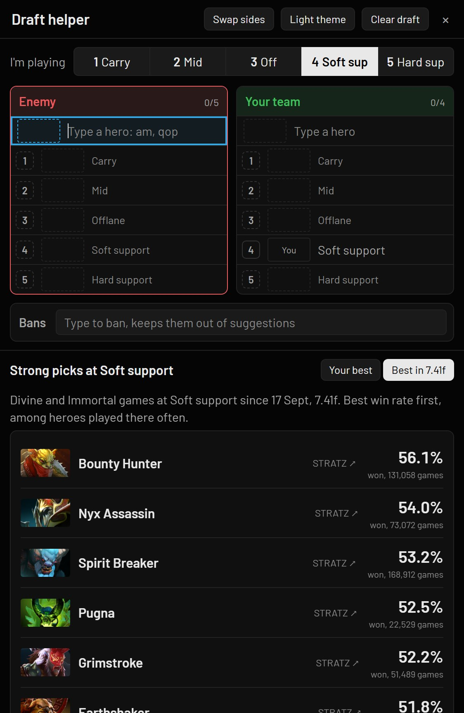
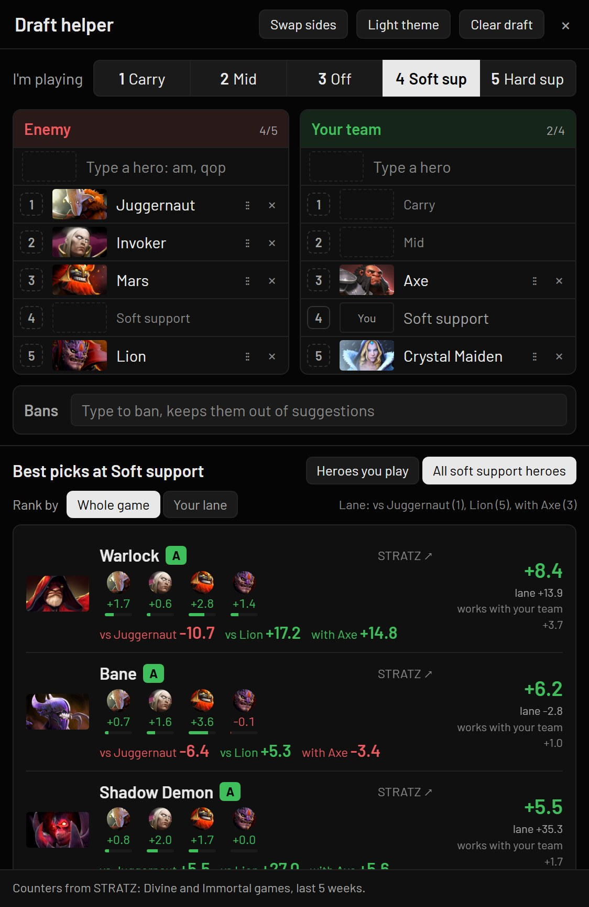
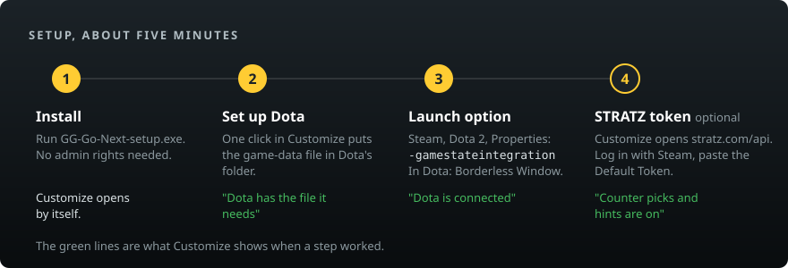
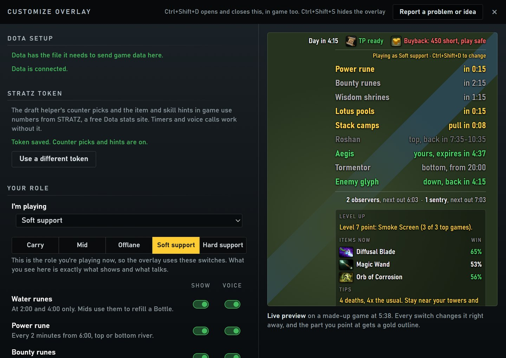

# GG Go Next

A free Windows overlay for Dota 2: map timers, voice calls, item and skill hints, and a draft helper.
Made by kalelooz. Free and open source, no account, no ads.

**[Download](../../releases/latest)** · [How it works](#how-it-works) · [Install](#install) · [FAQ](#faq)


## What it does

- **Timers** for power, bounty and water runes, wisdom shrines, lotus pools, camp stacks, Roshan's pit and
  respawn window, Aegis, Tormentor, the enemy glyph and your team's wards. Rules come from Valve's patch notes
  (currently 7.41f).
- **Voice calls** 20 seconds before runes, at stack time, and before Roshan changes pit. Each role has its own
  Show and Voice switches, so a carry isn't called for stacks and a support isn't told to farm ancients.
  With Jokes on, it also cracks the odd joke, like "No TP. Enjoy the walk." Eight voices to pick from.
  **[Listen to them (24-second video)](docs/voices.mp4)**.
- **Top strip** with day and night, TP, buyback (and how much gold you're short) and your courier.
- **Hints** at level-up (which ability most good players skill next), items that win more in your game, and
  neutral item picks.
- **Draft helper** in its own window. Type any hero, including old names and short forms (Wisp, Furion, AM),
  drag picks into Pos 1 to 5, and see which heroes do well against the enemy draft and in your lane, from
  Divine and Immortal games.

<table>
<tr>
<td width="50%"></td>
<td width="50%"></td>
</tr>
<tr>
<td><b>Before the draft.</b> Pick your role and see your own best heroes there, or the best ones this patch.</td>
<td><b>During the draft.</b> Type the enemy picks. Suggestions show how each hero does against every enemy and in your lane.</td>
</tr>
</table>

Press **Ctrl+Shift+D** in game to open Customize, and **Ctrl+Shift+S** to hide or show the overlay (handy while the shop is open). You can change both under Hotkeys in Customize. The tray icon has the draft helper, voice choice and your role.

## How it works


- It only reads Valve's **Game State Integration**, the official feed Dota sends to local apps you allow in a
  config file.
- It never reads game memory or game files, and never presses keys or clicks for you.
- The draft helper only knows the heroes you type in.

## Privacy

- No account, no login, no server of ours. Everything runs on your PC.
- Three online services, nothing else:
  - **STRATZ**, with your own free token, for the draft numbers and the in-game hints.
  - **Valve's image server**, for item and hero pictures.
  - **GitHub**, asked once at start whether a newer version is out. Turn off "Check for updates" in Customize to
    skip it. When you click Update now, the new setup also comes from GitHub.
- Your settings and STRATZ token stay in `%APPDATA%\com.kalelooz.gggonext`.
- Game-feed logs are off. Turn on "Save game-feed logs" in Customize only if you want to send a bug report.

## Install



1. Download `GG-Go-Next-setup.exe` from [Releases](../../releases) and run it. The release notes list its SHA-256;
   in PowerShell, `Get-FileHash GG-Go-Next-setup.exe` should print the same value. If you'd rather not install
   anything, `GG-Go-Next.exe` on the same page runs as it is.
2. Start GG Go Next from the Start menu. It lives in the tray, and the first time it opens Customize.
3. In Customize, click **Set up Dota**. It finds Dota through Steam and puts
   [gamestate_integration_gggonext.cfg](docs/gamestate_integration_gggonext.cfg) in Dota's folder. If it can't find
   Dota, copy that file by hand into `Steam\steamapps\common\dota 2 beta\game\dota\cfg\gamestate_integration\`
   (create the last folder if it's missing).
4. In Steam, right-click Dota 2, then Properties, and add `-gamestateintegration` to Launch Options. Customize shows
   "Dota is connected" once this works.
5. In Dota's video settings, pick **Borderless Window**, so the overlay can sit on top of the game.
6. For the draft helper's counter picks and the in-game hints, add a free STRATZ token. Customize's **STRATZ token**
   section walks you through it: **Open stratz.com/api**, log in with Steam, copy the **Default Token**, paste it and
   click Save. It checks the token with STRATZ before saving it.



Customize, after setup. Every switch updates the preview on the right as you flip it.

The files aren't code-signed, so Windows may show a SmartScreen warning. Pick "More info", then "Run anyway".

**Updates:** when a new version is out, the tray menu and Customize show it with an **Update now** button. One click
downloads the new setup, checks its signature, installs it with your settings kept and opens the app again. Nothing
installs without that click. Versions before 0.4.0, and the single exe, open the download page instead. After an update, a
"What's new" window lists the changes once; every version is in [CHANGELOG.md](CHANGELOG.md). To get an email
instead, click **Watch**, then **Custom**, then **Releases** at the top of this page.

**Uninstall:** remove GG Go Next in Windows Settings, then Apps, and delete the `.cfg` file from step 3. Without the
installer, delete the exe and the `com.kalelooz.gggonext` folders in `%APPDATA%` and `%LOCALAPPDATA%`.

## Build it yourself

Needs Node.js 22 or newer and Rust (stable).

```
cd app
npm ci
npm test
npx tauri build
```

The exe lands in `app/src-tauri/target/release/gg-go-next.exe` and the installer in
`app/src-tauri/target/release/bundle/nsis/`. Release builds come from the same steps on
GitHub Actions ([.github/workflows/build.yml](.github/workflows/build.yml)), so the download matches this code.

## Where things are

| Folder | What's in it |
|---|---|
| `app/src/` | The windows (`index.html` overlay, `draft.html`, `settings.html`, `topbar.html`, `skillbar.html`) and the game logic they share (`timers.js`, `roles.js`, `picks.js`, ...). Each `*.test.mjs` tests the file it's named after. |
| `app/src-tauri/` | The Rust side: listens for the game feed, runs the tray menu, and calls STRATZ. |
| `app/src/voice/` | The recorded voice clips, one folder per voice. |
| `docs/` | The game-feed config and the screenshots on this page. The two diagrams live in `app/src/guide/`, so Customize shows the same ones. |
| `tools/` | Scripts that rebuild the hero data, neutral item tables and voice clips. |

## FAQ

**Can I get banned for this?**
It uses only the feed Valve built for tools like this, and doesn't touch the game itself. Nobody outside Valve
can promise anything, but it does nothing Valve's anti-cheat looks for.

**Was AI used to make it?**
Yes. kalelooz plays Dota, designs the features, tests them in real games and decides what goes in. The code is
written with Claude Code.

**Something's wrong, or I have an idea.**
Click **Report a problem or idea** at the top of Customize (or in the tray menu) and pick bug, idea or question.
It opens a short form here on GitHub with your app version filled in; you need a free GitHub account. You can also
start from [New issue](../../issues/new/choose).

## Support

GG Go Next is free. If it helps your games, you can tip at [ko-fi.com/kalelooz](https://ko-fi.com/kalelooz).

## Credits

- Draft and item data: [STRATZ](https://stratz.com)
- Hero list: [dotaconstants](https://github.com/odota/dotaconstants) by OpenDota (MIT)
- Voices: [Kokoro](https://huggingface.co/hexgrad/Kokoro-82M) (Apache 2.0)

## License and disclaimer

MIT, see [LICENSE](LICENSE).

GG Go Next isn't affiliated with or endorsed by Valve. Dota 2 is a trademark of Valve Corporation. Item and hero
pictures load from Valve's servers and belong to Valve.
