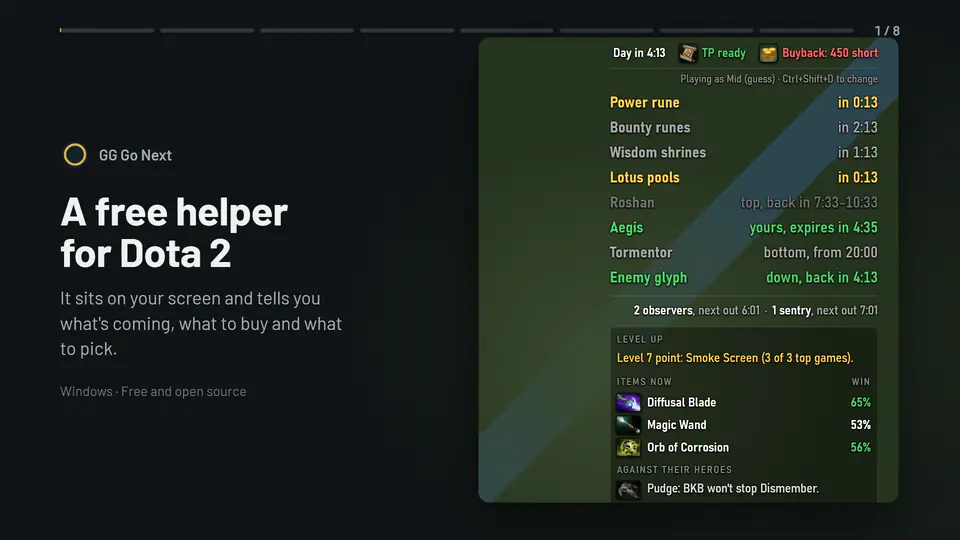

# GG Go Next

A free Dota 2 overlay for Windows. Timers, voice calls, item and skill hints, and a draft helper, all from the
game feed Valve made for tools like this. No account, no ads. Made by kalelooz.

**[Download for Windows](../../releases/latest)** · [Is it safe?](#is-it-safe) · [Setup](#setup) · [FAQ](#faq)

[Watch it with sound on the website (45 seconds)](https://kalelooz.github.io/gg-go-next/)

## What you get

- **Never miss a rune or a stack.** Timers for runes, shrines, lotus pools, stacks, Roshan, Aegis, Tormentor, the
  enemy glyph and your wards, with a voice call 20 seconds before.
- **Pick better.** The draft helper shows which heroes do well against the enemy draft and in your lane, from
  Divine and Immortal games.
- **Buy and skill better.** Items that win more right now, and the next skill most good players take.
- **Only what your role needs.** A carry isn't called for stacks, a support isn't told to farm ancients. You can
  change every switch per role.
- **A bit of fun.** Now and then a spoken joke, like "No TP. Enjoy the walk." Eight voices to pick from.

### Hear the voices

| Voice | Message | |
|---|---|---|
| Michael (US) | "Power rune and bounty in twenty seconds." | [▶ Listen](https://kalelooz.github.io/gg-go-next/#michael) |
| Fenrir (US) | "Roshan could be up now, top pit." | [▶ Listen](https://kalelooz.github.io/gg-go-next/#fenrir) |
| Puck (US) | "No TP. Enjoy the walk." | [▶ Listen](https://kalelooz.github.io/gg-go-next/#puck) |
| Heart (US) | "Stack in five." | [▶ Listen](https://kalelooz.github.io/gg-go-next/#heart) |
| Bella (US) | "They have an invisible hero. Carry dust or a sentry." | [▶ Listen](https://kalelooz.github.io/gg-go-next/#bella) |
| Nicole (US, soft) | "Dark map. Bring a flashlight." | [▶ Listen](https://kalelooz.github.io/gg-go-next/#nicole) |
| George (UK) | "Roshan is alive and lonely." | [▶ Listen](https://kalelooz.github.io/gg-go-next/#george) |
| Emma (UK) | "Skill point ready." | [▶ Listen](https://kalelooz.github.io/gg-go-next/#emma) |

<table>
<tr>
<td width="50%"></td>
<td width="50%"></td>
</tr>
<tr>
<td><b>Before the draft:</b> your best heroes for your role, or the best ones this patch.</td>
<td><b>During the draft:</b> type the enemy picks and see who counters them.</td>
</tr>
</table>

## Is it safe?

- It only uses Valve's **Game State Integration**, the official feed Dota sends to apps you allow.
- It never reads game memory or game files, and never presses keys or clicks for you.
- No account and no server of ours. Your settings stay on your PC.

## Setup

1. Download and run **[GG-Go-Next-setup.exe](../../releases/latest)**. Customize opens by itself.
2. Click **Set up Dota**.
3. In Steam, right-click Dota 2, then Properties, and add `-gamestateintegration` to Launch Options. In Dota's video
   settings, pick **Borderless Window**.
4. For the draft helper and hints, add a free STRATZ token. Customize walks you through it.

In game, **Ctrl+Shift+D** opens Customize and **Ctrl+Shift+S** hides the overlay. The **How it works** button in
Customize shows these pictures again.

## FAQ

**Can I get banned?**
It only uses the feed Valve built for tools like this and doesn't touch the game. Nobody outside Valve can promise
anything, but it does nothing Valve's anti-cheat looks for.

**Windows says the file might be unsafe.**
The files aren't code-signed yet, so SmartScreen warns about them. Pick "More info", then "Run anyway". Each release
lists the file's SHA-256, so you can check it's the real one with `Get-FileHash` in PowerShell.

**How do updates work?**
When a new version is out, Customize and the tray show **Update now**. One click installs it and keeps your
settings. Nothing installs without that click.

**Does it cost anything?**
No. If it helps your games, you can tip at [ko-fi.com/kalelooz](https://ko-fi.com/kalelooz).

**Something's wrong, or I have an idea.**
Click **Report a problem** in Customize, or **Report a problem or idea** in the tray. It opens a short form here with your version filled in. Code changes aren't open yet; [CONTRIBUTING.md](CONTRIBUTING.md) has the details.

**Was AI used to make it?**
Yes. kalelooz plays Dota, designs the features, tests them in real games and decides what goes in. The code is
written with Claude Code.

**How do I uninstall it?**
Remove GG Go Next in Windows Settings, then Apps, and delete `gamestate_integration_gggonext.cfg` from Dota's
`game\dota\cfg\gamestate_integration` folder.

<b>What it sends online</b>

Three services, nothing else:

- **STRATZ**, with your own free token, for the draft numbers and the in-game hints.
- **Valve's image server**, for hero and item pictures.
- **GitHub**, at start and then once an hour, to check for a newer version. Turn off "Check for updates" in Customize to skip it.

Settings and your STRATZ token stay in `%APPDATA%\com.kalelooz.gggonext`. Game-feed logs are off unless you turn
on "Save game-feed logs" for a bug report.

<b>Build it yourself</b>

Needs Node.js 22+ and Rust. `cd app`, `npm ci`, `npm test`, `npx tauri build`. Releases are built the same way on
GitHub Actions ([build.yml](.github/workflows/build.yml)), so the download matches this code. Every change is in
[CHANGELOG.md](CHANGELOG.md).

---

Data from [STRATZ](https://stratz.com). Hero list from [dotaconstants](https://github.com/odota/dotaconstants)
(MIT). Voices made with [Kokoro](https://huggingface.co/hexgrad/Kokoro-82M) (Apache 2.0). Font: [Barlow](https://github.com/jpt/barlow) (SIL OFL). GG Go Next is MIT
licensed ([LICENSE](LICENSE)) and isn't affiliated with or endorsed by Valve. Dota 2 is a trademark of Valve
Corporation; hero and item pictures load from Valve's servers and belong to Valve. Every license the app ships
with is in [third-party-notices.txt](app/src/third-party-notices.txt).
